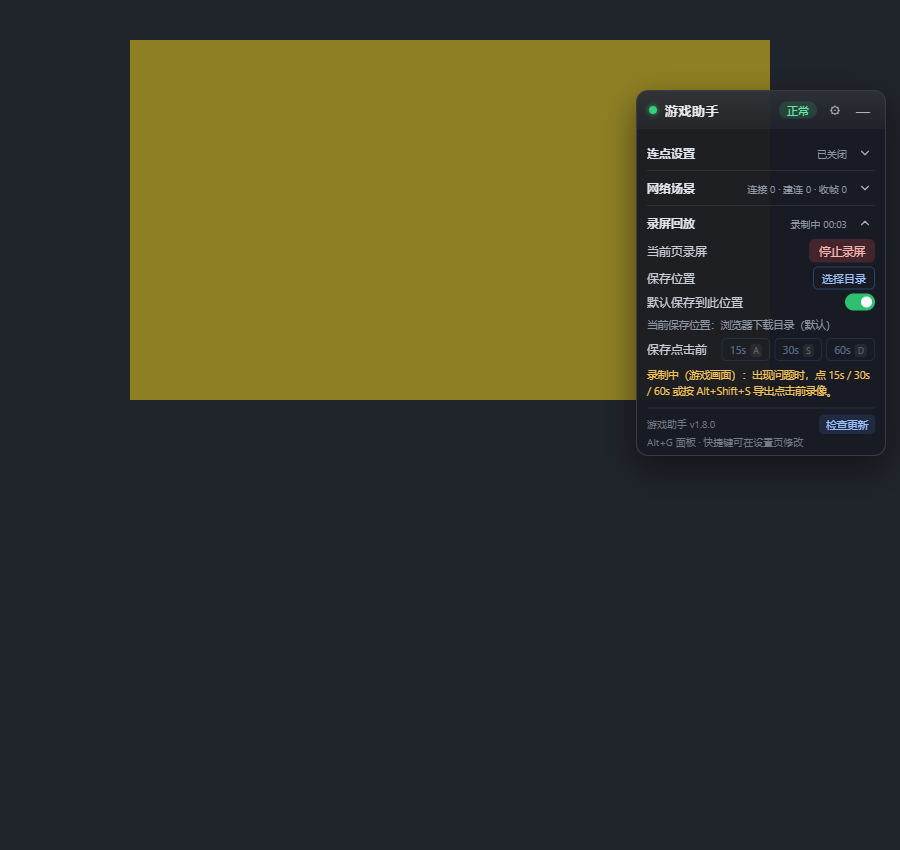
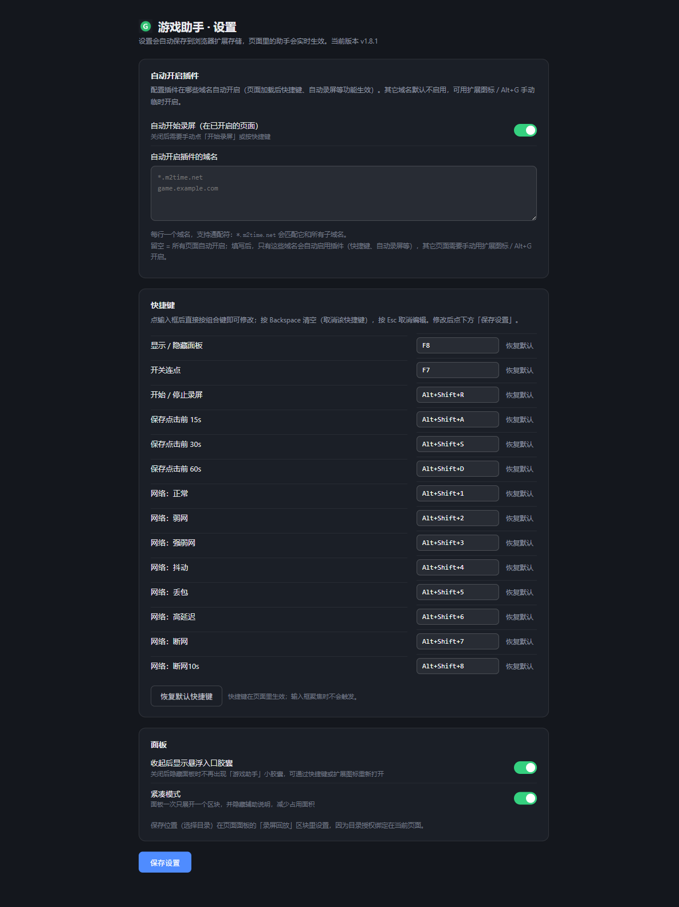

# 游戏测试助手（连点 / 网络 / 录屏）

面向 H5 / Cocos 网页游戏的测试工具（Chrome / Edge 扩展），用于复现连点、网络异常和问题现场：

1. **连点**：设定点击次数后，在游戏里手动点 1 次，自动补点到设定次数；支持 Pointer / 鼠标 / 触摸 / 真实输入（调试器）。
2. **网络场景**：正常 / 弱网 / 强弱网 / 抖动 / 丢包 / 高延迟 / 断网 / 断网10s / 自定义，直接作用于当前页 WebSocket 和 HTTP 请求。
3. **录屏回放**：自动录制当前页；出问题时一键导出「点击前 15s / 30s / 60s」的 MP4 视频，便于定位问题。
4. **设置页**：插件自动开启的域名、14 项可自定义快捷键、紧凑模式、收起后的入口胶囊等。




## 目录结构

```
├── extension/                  # 插件源码（手动加载这个目录）
│   ├── options.html/js         # 设置页
│   └── docs/                   # 截图
├── launcher/                   # 一键启动器（推荐给测试同事，不需要安装扩展）
├── dist/game-tool-extension.zip# 自动更新用的插件包
├── version.json                # 代码仓库检查更新用
└── README.md
```

## 方式一：手动加载扩展（Chrome / Edge）

1. 下载本仓库的 `extension/` 文件夹
2. 打开 `chrome://extensions`（Edge 为 `edge://extensions`）
3. 打开「开发者模式」→「加载已解压的扩展程序」→ 选择 `extension/` 文件夹
4. 打开任意页面后默认不显示面板，按默认快捷键 `F8`、`Alt+G` 或点扩展图标打开

> Chrome 137+ 已不支持命令行 `--load-extension`，手动加载方式不受影响。

## 方式二：一键启动器（推荐，无需安装扩展）

`launcher/` 是分发包：

1. 双击 `启动游戏助手.bat`
2. 自动把最新插件同步到本机，并用独立 Edge 配置打开游戏
3. 不需要装扩展、不需要重新加载

更新：双击 `launcher/检查更新.bat`，会读取本仓库的 `version.json` 自动下载安装；也可以在 `launcher/config.json` 里把 `autoCheck` 设为 `true`。

Chrome 用户：首次双击 `launcher/首次安装到Chrome.bat` 按提示加载一次；以后双击 `launcher/更新并重启Chrome.bat` 更新。

## 设置页

面板标题栏右侧 **⚙** 打开设置页（或扩展详情页 → 扩展选项），保存后页面实时生效。

- **自动开启插件**：配置哪些域名在页面加载时自动启用插件（快捷键、自动录屏等生效）。支持 `*.m2time.net` 通配符；留空 = 所有页面。其它域名默认休眠，可用扩展图标 / `Alt+G` 手动临时开启。
- **自动开始录屏**：在已开启的页面自动开始录制。
- **快捷键**：显示/隐藏面板、开关连点、开始/停止录屏、保存 15s/30s/60s、8 个网络场景，共 14 项可自定义。
- **面板**：紧凑模式（一次只展开一个区块，默认开启）、收起后是否显示悬浮入口胶囊。

## 录屏回放

- 优先录制游戏 canvas（不弹选择窗口、不会录到面板），没有 canvas 时回退到标签页选择。
- 按 **1 分钟滚动缓存**，只保留最近约 1 分钟，内存不会随挂机时长无限增长。
- 使用 **WebCodecs 边录边编码**，保存时只封装 MP4（通常 0.1 秒），MP4 可拖进度条、无二次压缩。
- 出问题后点 15s / 30s / 60s（或快捷键 `Alt+Shift+A/S/D`），导出 MP4（浏览器不支持时回退 WebM）。
- 保存/生成视频时录制会继续，不会暂停；手动停止或缓存超过 300MB 才停止。
- 缓存不足所选秒数时按实际时长导出，文件名标注实际秒数。
- 保存位置可在面板「录屏回放」区块选择目录并设为默认；未选择时使用浏览器默认下载目录。

## 检查更新原理

扩展本身不能从仓库热更新，更新检查在启动器里完成：

```
version.json（本仓库根目录）
        │  GET .../main/version.json
        ▼
launcher/update.ps1 → 比较版本 → 下载 dist/game-tool-extension.zip → 解压覆盖本机插件 → 重启后生效
```

发新版：更新 `extension/` 和 `dist/game-tool-extension.zip`，改 `version.json` 的版本号，提交即可。

## 注意

- 仅供测试环境使用；高次数连点前确认点击位置不会触发真实支付、抽卡等不可逆操作。
- 仓库不包含任何测试账号/密码，请使用自己的测试账号登录。
- 网络模拟只影响当前页面里的游戏请求，不会修改系统网络。

当前版本 **v1.9.5**。
