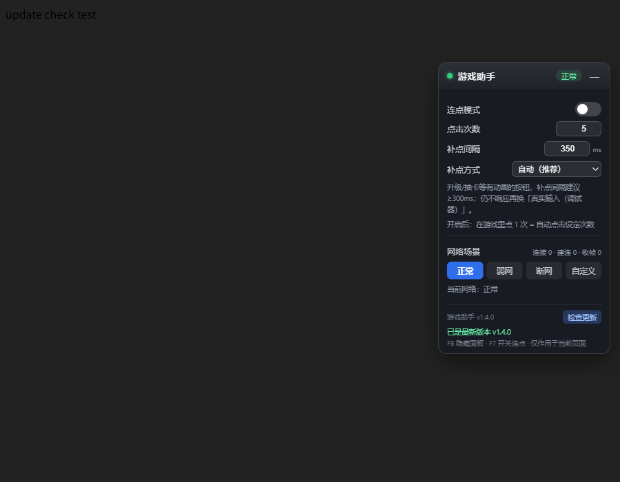
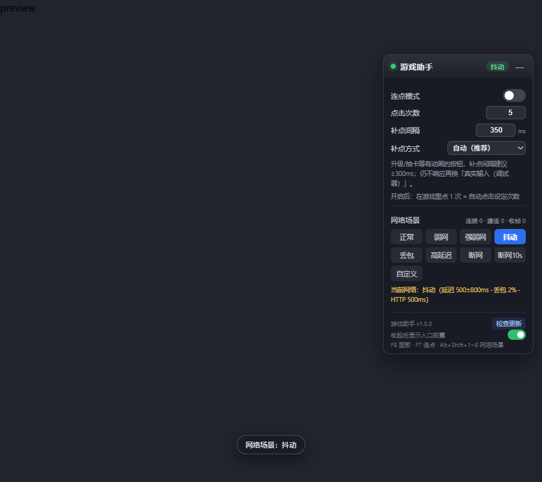
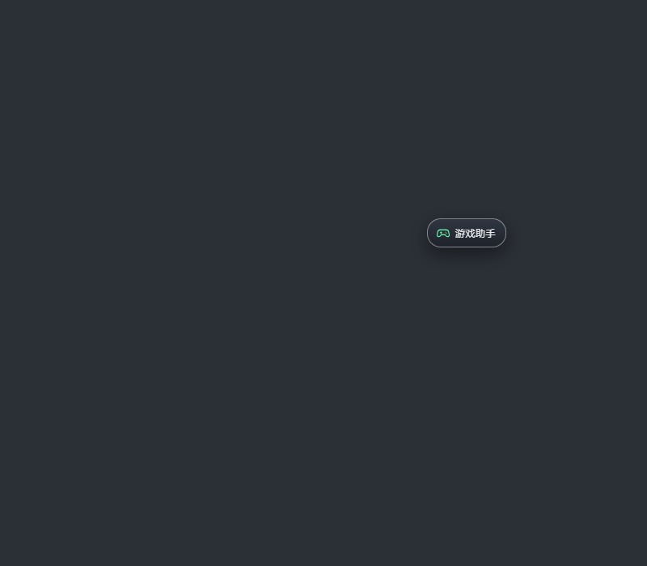
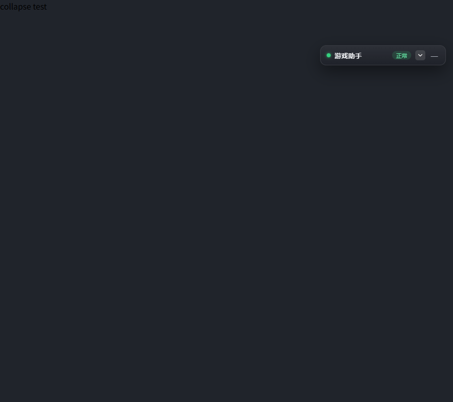

# 游戏连点 & 网络异常助手

一个在游戏页面里浮动显示的小插件（Chrome / Edge 扩展），用于两件事：

1. **连点**：设定点击次数，开启后你在游戏里手动点 1 次，插件会自动补点到设定次数。
2. **网络场景**：一键切换 正常 / 弱网 / 强弱网 / 抖动 / 丢包 / 高延迟 / 断网 / 断网10s / 自定义，直接作用于当前游戏的 WebSocket 与 HTTP 请求；支持 `Alt+Shift+1~8` 快捷键。

所有网页通用：**默认不显示面板**；需要时点浏览器右上角的扩展图标、按 `Alt+G` 或 `F8` 打开（收起后是小胶囊，可拖动，单击展开）。


## 安装 / 更新

### 方式一：手动加载扩展（Chrome / Edge）

1. 下载本仓库的 `extension` 文件夹到本地。
2. 打开浏览器扩展管理页：
   - Chrome：地址栏输入 `chrome://extensions`
   - Edge：地址栏输入 `edge://extensions`
3. 打开右上角「开发者模式」。
4. 点击「加载已解压的扩展程序」，选择 `extension` 文件夹。
5. 打开任意页面后默认不显示面板；点浏览器右上角扩展图标（建议先固定到工具栏）、按 `Alt+G` 或 `F8` 打开。

> 提示：Chrome 137+ 已不支持用 `--load-extension` 命令行自动加载扩展，但上面的「加载已解压的扩展程序」手动方式不受影响。

### 方式二：一键启动器（推荐给测试同事）

用仓库根目录的 `launcher/` 文件夹：双击 `启动游戏助手.bat`，会自动同步最新插件并用独立 Edge 配置打开游戏，**不需要安装扩展、不需要重新加载**。

更新时双击 `launcher/检查更新.bat`，会从本仓库的 `version.json` 检查并下载最新版。

### 更新

- 启动器用户：双击 `launcher/检查更新.bat`（或在 `launcher/config.json` 里把 `autoCheck` 设为 `true`，每次启动自动检查）。
- 手动加载扩展的用户：用新版覆盖本地 `extension` 文件夹，然后在扩展管理页点「重新加载」。
- 确认版本：面板底部显示 `游戏助手 v1.5.1`。
- 面板底部新增「检查更新」按钮：点击后可查询本仓库最新版本，发现新版本会提示并给出更新入口（扩展本身不能自安装，自动更新请用启动器）。



## 使用

### 连点

| 设置 | 说明 |
| --- | --- |
| 连点模式 | 打开开关后生效 |
| 点击次数 | 总点击次数，包含你手动点的那一次。例如填 5，你点一下游戏，合计会点击 5 次 |
| 补点间隔 | 自动补点之间的间隔（毫秒），默认 350ms；按钮有动画/冷却时建议 300~500ms，设太小容易被游戏忽略 |
| 补点方式 | 自动（推荐）：同时发送 Pointer + 鼠标/触摸事件；也可手动指定 Pointer / 鼠标 / 触摸；游戏不响应时选「真实输入（调试器）」 |

- 只有点击网页内容才触发补点；点击面板上的按钮/输入框不会触发。
- 点击位置跟随你手动点击的位置（支持鼠标、触控笔、触摸）。
- 设置会自动保存；所有网页通用。
- 快捷键：`F7` 开关连点，`F8` 显示/隐藏面板（`F8` 在面板隐藏时也能打开），`Alt+G` 全局显示/隐藏面板。
- **如果游戏没反应**：先看面板状态行的「本次已补 N 次 · 方式 · 目标」。
  - 有补点次数但游戏没反应：把「补点方式」换成「真实输入（调试器）」（需要先关闭 DevTools，Chrome 地址栏下方会出现调试提示条，属正常现象）。
  - 如果登录界面被面板挡住输入框：按 `F8` 先隐藏面板，登录后再按 `F8` 打开，或直接拖动面板移开。

### 网络场景

9 个场景一键切换：

| 场景 | 效果 |
| --- | --- |
| 正常 | 不做任何干预 |
| 弱网 | WS 延迟 1000ms + 10% 丢包；HTTP 延迟 1000ms |
| 强弱网 | WS 延迟 3000ms + 30% 丢包；HTTP 延迟 3000ms |
| 抖动 | WS 延迟 500ms ±800ms；HTTP 延迟 500ms（带抖动） |
| 丢包 | WS 延迟 100ms + 30% 丢包 |
| 高延迟 | WS/HTTP 延迟 2500ms，不丢包 |
| 断网 | 强制断开当前 WebSocket，并阻止新建连接；HTTP 请求直接失败 |
| 断网10s | 断网 10 秒后自动恢复「正常」 |
| 自定义 | 自己填 WS 延迟、抖动范围、丢包率、HTTP 延迟，点「应用自定义网络」 |

快捷键（组合键，避免和游戏/浏览器冲突）：

| 快捷键 | 场景 |
| --- | --- |
| `Alt+Shift+1` | 正常 |
| `Alt+Shift+2` | 弱网 |
| `Alt+Shift+3` | 强弱网 |
| `Alt+Shift+4` | 抖动 |
| `Alt+Shift+5` | 丢包 |
| `Alt+Shift+6` | 高延迟 |
| `Alt+Shift+7` | 断网 |
| `Alt+Shift+8` | 断网10s |



- 切换立即生效，面板标题旁的小标签显示当前网络状态；切换时页面底部会短暂提示场景名。
- 断网后切回「正常」：如果游戏没有自动重连，请在游戏内点「重连网络」或重启游戏（和真实断网表现一致）。
- 面板显示当前 WS 连接数、建连次数、收帧数，方便确认异常是否生效。
- 断网/弱网只作用于当前页面里的游戏请求，不会修改电脑系统网络。

### 面板拖动与收起

- 按住面板任意非按钮/输入框区域即可拖动（标题栏、空白处都可以）。
- 拖动后自动记住位置，下次打开留在原处，并会自动限制在窗口范围内。
- `F8` 或点标题栏「—」收起面板，会变成右侧的「游戏助手」小胶囊：

  

- 小胶囊同样可以**按住拖动**并记住位置；**单击**它展开面板。
- 胶囊右侧有 **×**：点击可隐藏这个入口（之后按 `Alt+G` / `F8` / 扩展图标重新打开面板）。
- 不想每次收起都出现胶囊：在面板底部关掉「收起后显示入口胶囊」。
- 标题栏右侧的收起按钮（⌃ / ⌄）可以在面板内**收起 / 展开内容**：收起后只剩标题栏（网络状态仍然显示），面板高度约 40px，但不会隐藏面板；展开/收起状态会自动记住。

  

## 已验证的行为（本游戏）

- 任意网页打开时默认不显示面板；点扩展图标 / `Alt+G` / `F8` 打开；按 `F8` 收起为「游戏助手」小胶囊，单击胶囊展开。
- 测试账号 / 两仪玄宫（2服）/ 养成 → 古玩 → 玉山水 实测：
  - 面板设置点击次数 5、间隔 150ms、自动模式后，手动点一次「升级」，面板显示“本次已补 4 次”，玉山水等级从 679 级连续升到 682 级（部分点击会被升级动画/冷却吃掉，间隔调到 300ms 左右可让每次补点都生效）。


- 点击面板按钮不会触发补点；普通网页上的点击倍率同样生效（实测 4 次点击=手动 1 次+补 3 次）。
- 面板可自由拖动并保持在窗口内。
- 断网后 WS 连接被断开（连接数归零、建连次数增加），切回正常后网络能力恢复。
- 弱网/自定义的延迟、丢包参数正确作用于游戏，页面无异常。
- 实测环境：Edge（与 Chrome 同内核）；Chrome 手动加载同样可用。

## 版本历史

- v1.5.1：面板标题栏新增「收起 / 展开内容」按钮，收起后只剩标题栏（约 40px 高，网络状态仍可见），状态自动记住。
- v1.5.0：网络场景扩展为 9 个（新增 强弱网 / 抖动 / 丢包 / 高延迟 / 断网10s），新增 `Alt+Shift+1~8` 组合快捷键；收起后的「游戏助手」胶囊可点 × 隐藏，面板可关闭“收起后显示入口胶囊”。
- v1.4.0：面板新增「检查更新」按钮，直接从 GitHub 仓库读取版本并提示更新。
- v1.3.3：改回**默认不显示**面板；需要时通过扩展图标 / `Alt+G` / `F8` 打开，适合不想让面板常驻页面的场景。
- v1.3.2：去掉 `*.m2time.net` 域名限制，所有网页默认显示面板，任意页面/游戏都能直接用；F8 / 扩展图标 / Alt+G 收起或打开。
- v1.3.1：收起后的样式改为「游戏助手」小胶囊（不再是丑圆形），胶囊支持拖动并记住位置，单击展开；面板仍未生效时请确认底部版本号。
- v1.3.0：面板显示版本号；补点间隔默认改为 350ms（老版本 60ms 间隔自动迁移一次），解决按钮动画/冷却导致补点被游戏忽略的问题。
- v1.2.0：新增「补点方式」（自动 / Pointer / 鼠标 / 触摸 / 真实输入）；修复连点模式下部分游戏按钮只认鼠标事件、导致“显示已补点但游戏没反应”的问题；新增真实输入（调试器）兜底；登录界面被面板遮挡时可按 F8 隐藏。
- v1.1.0：支持所有网页（工具栏图标 / Alt+G / F8 打开）；面板整块可拖、自动记忆位置、限制窗口内；增加后台脚本与图标。
- v1.0.0：首个版本，仅游戏域名可用，Pointer 事件补点。

## 原理与文件

```
manifest.json     扩展清单（Manifest V3）
background.js     后台脚本：工具栏图标 / Alt+G 切换面板，必要时按需注入脚本
page-inject.js    注入到页面（MAIN world）：包装 WebSocket（延迟/丢包/断网）和 fetch/XHR，并回传状态
content.js        浮层面板（ISOLATED world）：连点设置、网络按钮、拖动、状态显示、持久化
icons/            扩展图标
docs/preview.png  预览图
```

- **连点**：在页面捕获真实点击后，按设定次数补发 `pointerdown/pointerup`。这个游戏只认 PointerEvent，所以补发 PointerEvent（已验证可正常推进剧情）。
- **弱网/丢包**：包装 `WebSocket`，对消息事件延迟或按概率丢弃；对 `send` 同样处理。
- **断网**：关闭现有 WebSocket；之后游戏新建的 WebSocket 会连接到一个必定失败的地址，模拟服务器不可达；HTTP 请求直接失败。
- **通用性**：内容脚本在所有网页加载，但面板默认不显示，通过扩展图标 / `Alt+G` / `F8` 打开；网络包装默认是“透传”，只有切换网络场景后才改变行为。
- **通信**：面板、页面脚本、后台脚本之间全部本地完成，不联网、不上报数据。

## 权限说明

- `存储`：保存连点设置和面板位置。
- `读取和更改所有网站数据`：因为插件要在任意网页上都能打开、并对游戏网络做模拟，所以需要此权限；所有逻辑都在本地运行，不收集不上传数据。
- `scripting` / `activeTab`：扩展安装/更新前就已经打开的页面，点图标时按需注入脚本。
- `调试器`：仅在你手动选择「真实输入（调试器）」补点方式时使用，通过 Chrome 调试协议发送真实鼠标/触摸事件；使用期间浏览器会显示调试提示条，发送完会自动断开。

## 注意事项

- 仅供测试环境使用。开启高次数连点前，确认点击位置不会触发真实支付、抽卡、购买等不可逆操作。
- 「断网」只影响当前页面里的游戏请求，不影响浏览器其他标签页。
- 网络包装在所有页面生效但默认透传；如果某个网站与插件冲突，可在扩展管理页临时停用本插件。
- 如果游戏更新导致指针事件类型变化（例如改为只监听合成鼠标事件或触摸事件），补点可能失效；可反馈我再适配。
