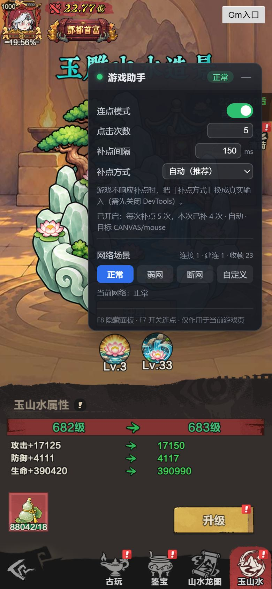
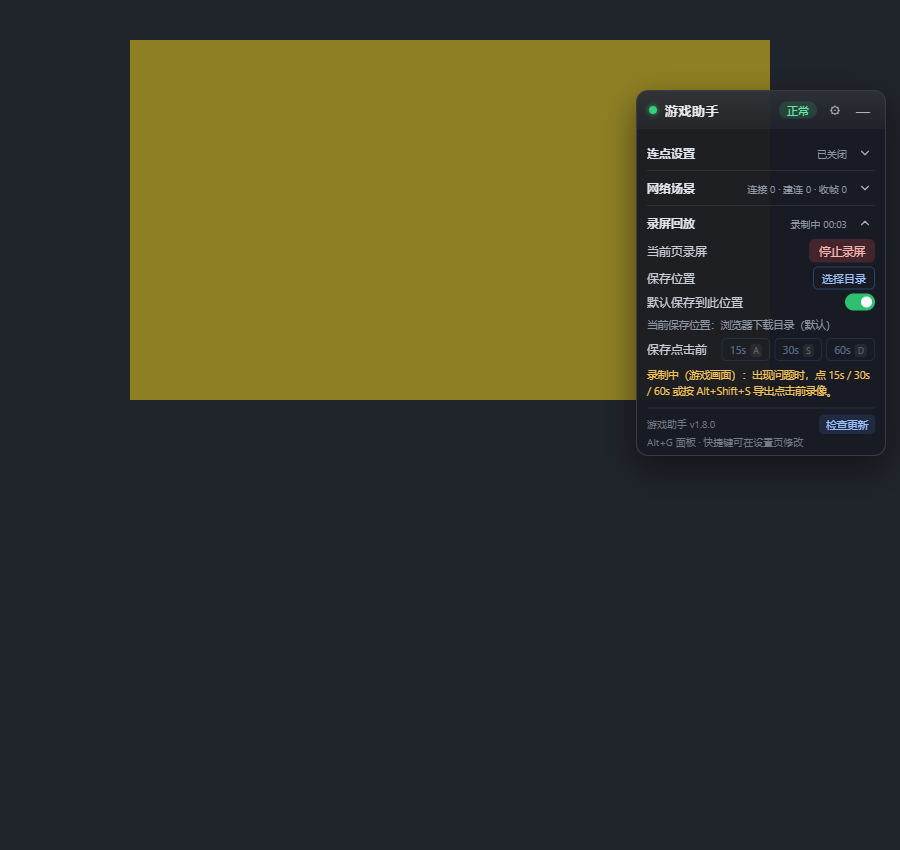
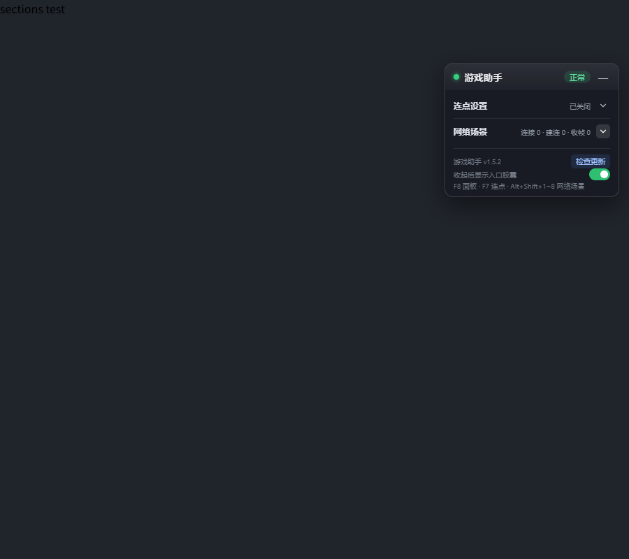
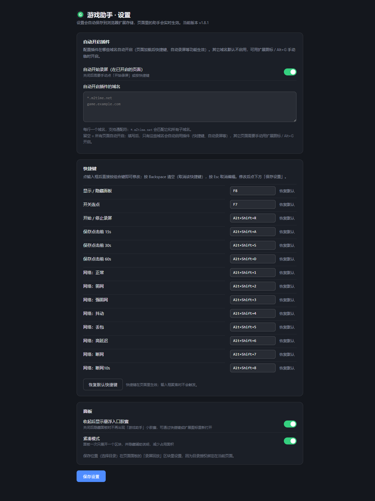

# 游戏测试助手（连点 / 网络 / 录屏）

一个在游戏页面里浮动显示的小插件（Chrome / Edge 扩展），用于两件事：

1. **连点**：设定点击次数，开启后你在游戏里手动点 1 次，插件会自动补点到设定次数。
2. **网络场景**：一键切换 正常 / 弱网 / 强弱网 / 抖动 / 丢包 / 高延迟 / 断网 / 断网10s / 自定义，直接作用于当前游戏的 WebSocket 与 HTTP 请求；支持 `Alt+Shift+1~8` 快捷键。
3. **录屏回放**：开始录制当前页，出问题时点 15s / 30s / 60s，导出点击前对应长度的视频，方便复现和定位问题。

所有网页通用：**默认不显示面板**；需要时点浏览器右上角的扩展图标、按 `Alt+G` 或 `F8` 打开（收起后是小胶囊，可拖动，单击展开）。



## 安装 / 更新

### 方式一：手动加载扩展（Chrome / Edge）

1. 下载本仓库的 `extension/` 文件夹到本地。
2. 打开浏览器扩展管理页：Chrome `chrome://extensions`，Edge `edge://extensions`。
3. 打开右上角「开发者模式」。
4. 点「加载已解压的扩展程序」，选择 `extension/` 文件夹。
5. 打开任意页面后默认不显示面板；点浏览器右上角扩展图标、按 `Alt+G` 或默认快捷键 `F8` 打开（快捷键和触发域名可在设置页修改）。

> Chrome 137+ 已不支持命令行 `--load-extension`，手动加载方式不受影响。

### 方式二：一键启动器（推荐给测试同事）

仓库根目录的 `launcher/`：双击 `启动游戏助手.bat`，自动同步最新插件并用独立 Edge 配置打开；双击 `检查更新.bat` 从本仓库更新。

### 更新

- 启动器用户：双击 `launcher/检查更新.bat`。
- 手动加载扩展的用户：用新版覆盖本地 `extension/` 文件夹，然后在扩展管理页点「重新加载」。
- 确认版本：面板底部显示 `游戏助手 v1.9.5`。

## 分发给同事

见仓库根目录的 `launcher/`，或使用 `launcher/检查更新.bat` 自动更新；详细说明见 `launcher/使用说明.md`。

## 使用

### 连点

| 设置 | 说明 |
| --- | --- |
| 连点模式 | 打开开关后生效 |
| 点击次数 | 总点击次数，包含你手动点的那一次。例如填 5，你点一下游戏，合计会点击 5 次 |
| 补点间隔 | 自动补点之间的间隔（毫秒），默认 350ms；按钮有动画/冷却时建议 300~500ms，设太小容易被游戏忽略 |
| 补点方式 | 自动（推荐）：同时发送 Pointer + 鼠标/触摸事件；也可手动指定 Pointer / 鼠标 / 触摸；游戏不响应时选「真实输入（调试器）」 |

- 只有点击网页内容才触发补点；点击面板上的按钮/输入框不会触发。
- 点击位置跟随你手动点击的位置（支持鼠标、触控笔、触摸）。
- 设置会自动保存；所有网页通用。
- 快捷键：`F7` 开关连点，`F8` 显示/隐藏面板（`F8` 在面板隐藏时也能打开），`Alt+G` 全局显示/隐藏面板。
- **如果游戏没反应**：先看面板状态行的「本次已补 N 次 · 方式 · 目标」。
  - 有补点次数但游戏没反应：把「补点方式」换成「真实输入（调试器）」（需要先关闭 DevTools，Chrome 地址栏下方会出现调试提示条，属正常现象）。
  - 如果登录界面被面板挡住输入框：按 `F8` 先隐藏面板，登录后再按 `F8` 打开，或直接拖动面板移开。

### 网络场景

9 个场景一键切换：

| 场景 | 效果 |
| --- | --- |
| 正常 | 不做任何干预 |
| 弱网 | WS 延迟 1000ms + 10% 丢包；HTTP 延迟 1000ms |
| 强弱网 | WS 延迟 3000ms + 30% 丢包；HTTP 延迟 3000ms |
| 抖动 | WS 延迟 500ms ±800ms；HTTP 延迟 500ms（带抖动） |
| 丢包 | WS 延迟 100ms + 30% 丢包 |
| 高延迟 | WS/HTTP 延迟 2500ms，不丢包 |
| 断网 | 强制断开当前 WebSocket，并阻止新建连接；HTTP 请求直接失败 |
| 断网10s | 断网 10 秒后自动恢复「正常」 |
| 自定义 | 自己填 WS 延迟、抖动范围、丢包率、HTTP 延迟，点「应用自定义网络」 |

快捷键：`Alt+Shift+1` 正常、`Alt+Shift+2` 弱网、`Alt+Shift+3` 强弱网、`Alt+Shift+4` 抖动、`Alt+Shift+5` 丢包、`Alt+Shift+6` 高延迟、`Alt+Shift+7` 断网、`Alt+Shift+8` 断网10s。


- 切换立即生效，面板标题旁的小标签显示当前网络状态；切换时页面底部会短暂提示场景名。
- 断网后切回「正常」：如果游戏没有自动重连，请在游戏内点「重连网络」或重启游戏（和真实断网表现一致）。
- 断网/弱网只作用于当前页面里的游戏请求，不会修改电脑系统网络。

### 录屏回放（保存点击前 N 秒）

面板「录屏回放」区块（默认收起）→ 点「开始录屏」，出现问题时点 15s / 30s / 60s，会导出点击前对应长度的 WebM 视频。

- **插件加载后默认自动开始录屏**（优先游戏 canvas，不弹窗）；可在录屏区块关闭「自动开始录屏」，手动停止后不会自动重启。
- 优先直接录制页面里的游戏 canvas：**不弹选择窗口、不录面板**；页面没有 canvas 时回退到标签页录屏（会弹出选择窗口，选当前标签页即可）。
- **保存/生成视频时录制不会暂停或停止**，会继续缓存；只有手动停止、关闭页面才停止。
- 使用 WebCodecs 持续编码，只保留最近约 1 分钟缓存，内存不会随录制时长增长；保存时只封装 MP4，速度很快且可拖进度条。
- 缓存不足 15s / 30s / 60s 时**按实际时长导出**，文件名和状态会标注实际秒数（例如「前5s」）。
- 视频**默认 MP4（H.264）**；浏览器不支持 MP4 时自动回退 WebM，文件扩展名与格式一致。
- 默认快捷键：`Alt+Shift+R` 开始/停止录屏；`Alt+Shift+A` 保存点击前 15s；`Alt+Shift+S` 保存 30s；`Alt+Shift+D` 保存 60s。所有快捷键都可以在**设置页**修改。
- **保存位置**：点录屏区块的「选择目录」可指定文件夹并记住（首次可能请求写入权限）；勾选「默认保存到此位置」时直接写入该目录，取消勾选则每次保存弹出位置选择。
- 没有选择目录、或浏览器不支持位置选择时，保存到浏览器默认下载目录。
- 浏览器只暴露所选目录的名称，不提供完整路径；长目录名会自动换行显示，不会截断。
- 点 15s / 30s / 60s 后按原速回放裁剪，生成需要约 N 秒，状态行会显示进度。
- 点「停止录屏」停止采集，已缓存片段仍可继续保存。
- 录制缓存按 1 分钟分段滚动，只保留最近约 1~2 分钟；保存时会自动拼接多个分段，仍可导出完整的点击前 15s/30s/60s。
- 文件名格式：`游戏助手回放-YYYYMMDD-HHmmss-前Ns.mp4`（不支持 MP4 时为 `.webm`），下载到浏览器默认下载目录。



### 面板拖动与收起

- 按住面板任意非按钮/输入框区域即可拖动（标题栏、空白处都可以）。
- 拖动后自动记住位置，下次打开留在原处，并会自动限制在窗口范围内。
- `F8` 或点标题栏「—」收起面板，会变成右侧的「游戏助手」小胶囊：

  

- 小胶囊同样可以**按住拖动**并记住位置；**单击**它展开面板。
- 胶囊右侧有 **×**：点击可隐藏这个入口（之后按 `Alt+G` / `F8` / 扩展图标重新打开面板）。
- 不想每次收起都出现胶囊：在面板底部关掉「收起后显示入口胶囊」。
- 「连点设置」和「网络场景」两个区块可以**分别收起 / 展开**：点区块标题（或右侧 ⌃）即可折叠，状态自动记住；收起后标题行仍显示关键信息（连点开关/次数、连接数等）。

  

## 设置页

点面板标题栏右侧的 **⚙** 按钮打开设置页（也可以从扩展详情页 → 扩展选项进入），设置会实时同步到已打开的页面。

设置页里放低频配置：

- **自动开启插件**：配置哪些域名在页面加载时自动启用插件（快捷键、自动录屏等功能生效）。每行一个域名，支持 `*.m2time.net` 通配符；留空 = 所有页面自动开启。
  其它域名默认不启用：快捷键不响应、不会自动录屏；点扩展图标或按 `Alt+G` 可手动临时开启，开启后按「自动开始录屏」设置决定是否开始录制。
- **快捷键**：显示/隐藏面板、开关连点、开始/停止录屏、保存 15s/30s/60s、8 个网络场景，共 14 项全部可自定义。点输入框后按组合键即可；Backspace 清空、Esc 取消；支持恢复默认。
- **面板**：收起面板后是否显示「游戏助手」悬浮胶囊；**紧凑模式**（默认开启）：一次只展开一个区块、隐藏辅助说明，并限制面板最大高度，减少占用面积。

面板里只保留高频操作：连点参数、网络场景、录屏开始/停止、保存 15s/30s/60s、保存位置和检查更新。



## 已验证的行为（本游戏）

- 任意网页打开时默认不显示面板；点扩展图标 / `Alt+G` / `F8` 打开；按 `F8` 收起为「游戏助手」小胶囊，单击胶囊展开。
- 测试账号 / 两仪玄宫（2服）/ 养成 → 古玩 → 玉山水 实测：
  - 面板设置点击次数 5、间隔 150ms、自动模式后，手动点一次「升级」，面板显示“本次已补 4 次”，玉山水等级从 679 级连续升到 682 级（部分点击会被升级动画/冷却吃掉，间隔调到 300ms 左右可让每次补点都生效）。


- 点击面板按钮不会触发补点；普通网页上的点击倍率同样生效（实测 4 次点击=手动 1 次+补 3 次）。
- 面板可自由拖动并保持在窗口内。
- 断网后 WS 连接被断开（连接数归零、建连次数增加），切回正常后网络能力恢复。
- 弱网/自定义的延迟、丢包参数正确作用于游戏，页面无异常。
- 实测环境：Edge（与 Chrome 同内核）；Chrome 手动加载同样可用。

## 版本历史

- v1.9.0：录屏改为 WebCodecs 边录边编码 + MP4 封装；保存几乎瞬间完成、MP4 可拖进度条、无二次压缩更清晰。老浏览器不支持时回退原来的 MediaRecorder 方案。
- v1.8.2：录屏缓存改为 1 分钟分段滚动，只保留最近约 1~2 分钟；保存时自动拼接多个分段，仍可导出完整的点击前 15s/30s/60s。
- v1.8.1：域名配置改为「自动开启插件的域名」：只有配置的域名在页面加载时自动启用插件；其它域名默认休眠（快捷键/自动录屏不生效），可用扩展图标或 Alt+G 手动临时开启。
- v1.8.0：新增默认开启的「紧凑模式」：面板一次只展开一个区块、隐藏辅助说明、限制最大高度，面板高度约 300px；可在设置页关闭紧凑模式查看全部内容。
- v1.7.1：保存位置文字支持自动换行，长目录名不再被截断；确认提示改为短句「已选择目录：…」，面板宽度不足时也能完整显示；面板重新显示时会自动拉回窗口内，避免右侧被裁掉。
- v1.7.0：新增扩展设置页：自动录屏域名白名单、14 项可自定义快捷键、收起后是否显示入口胶囊；面板移除低频设置并新增 ⚙ 入口；录制缓冲改为 WebM、导出仍然转 MP4，避免 MP4 缓冲延迟导致刚开录保存失败。
- v1.6.4：新增「保存位置」：可选择保存目录并记住；勾选「默认保存到此位置」时静默写入该目录，取消勾选则每次保存弹出位置选择；不支持时回退浏览器默认下载目录。
- v1.6.3：保存按钮上直接标注快捷键（15s-A / 30s-S / 60s-D，对应 Alt+Shift+A/S/D）；真实扩展环境验证 `Alt+Shift+A` 成功保存 MP4 且录制继续。
- v1.6.2：录屏输出改为 **MP4（H.264）**，浏览器不支持时自动回退 WebM；新增 `Alt+Shift+A/S/D` 分别保存点击前 15s/30s/60s；保存前会主动刷新录像数据，避免刚录几秒保存失败。
- v1.6.1：录屏改为插件加载后默认自动开始（可关闭）；保存/生成视频时录制继续、不暂停；新增 `Alt+Shift+R` 开始/停止录屏、`Alt+Shift+S` 保存点击前 30s；缓存不足所选秒数时按实际时长导出。
- v1.6.0：新增「录屏回放」：开始录屏后可持续缓存当前页（优先游戏 canvas），点 15s/30s/60s 导出点击前对应长度的 WebM 视频，便于定位异常。
- v1.5.2：改为「连点设置」和「网络场景」两个区块**分别收起 / 展开**，各自记住状态，收起后标题行仍显示关键信息。
- v1.5.1：面板标题栏新增「收起 / 展开内容」按钮，收起后只剩标题栏（约 40px 高，网络状态仍可见），状态自动记住。
- v1.5.0：网络场景扩展为 9 个（新增 强弱网 / 抖动 / 丢包 / 高延迟 / 断网10s），新增 `Alt+Shift+1~8` 组合快捷键；收起后的「游戏助手」胶囊可点 × 隐藏，面板可关闭“收起后显示入口胶囊”。
- v1.4.0：面板新增「检查更新」按钮，可直接从 GitHub 仓库读取版本并提示更新。
- v1.3.3：改回**默认不显示**面板；需要时通过扩展图标 / `Alt+G` / `F8` 打开，适合不想让面板常驻页面的场景。
- v1.3.2：去掉 `*.m2time.net` 域名限制，所有网页默认显示面板，任意页面/游戏都能直接用；F8 / 扩展图标 / Alt+G 收起或打开。
- v1.3.1：收起后的样式改为「游戏助手」小胶囊（不再是丑圆形），胶囊支持拖动并记住位置，单击展开；面板仍未生效时请确认底部版本号。
- v1.3.0：面板显示版本号；补点间隔默认改为 350ms（老版本 60ms 间隔自动迁移一次），解决按钮动画/冷却导致补点被游戏忽略的问题。
- v1.2.0：新增「补点方式」（自动 / Pointer / 鼠标 / 触摸 / 真实输入）；修复连点模式下部分游戏按钮只认鼠标事件、导致“显示已补点但游戏没反应”的问题；新增真实输入（调试器）兜底；登录界面被面板遮挡时可按 F8 隐藏。
- v1.1.0：支持所有网页（工具栏图标 / Alt+G / F8 打开）；面板整块可拖、自动记忆位置、限制窗口内；增加后台脚本与图标。
- v1.0.0：首个版本，仅游戏域名可用，Pointer 事件补点。

## 原理与文件

```
manifest.json     扩展清单（Manifest V3）
background.js     后台脚本：工具栏图标 / Alt+G 切换面板，必要时按需注入脚本
page-inject.js    注入到页面（MAIN world）：包装 WebSocket（延迟/丢包/断网）和 fetch/XHR，并回传状态
content.js        浮层面板（ISOLATED world）：连点设置、网络按钮、拖动、状态显示、持久化
icons/            扩展图标
docs/preview.png  预览图
```

- **连点**：在页面捕获真实点击后，按设定次数补发 `pointerdown/pointerup`。这个游戏只认 PointerEvent，所以补发 PointerEvent（已验证可正常推进剧情）。
- **弱网/丢包**：包装 `WebSocket`，对消息事件延迟或按概率丢弃；对 `send` 同样处理。
- **断网**：关闭现有 WebSocket；之后游戏新建的 WebSocket 会连接到一个必定失败的地址，模拟服务器不可达；HTTP 请求直接失败。
- **通用性**：内容脚本在所有网页加载，但面板默认不显示，通过扩展图标 / `Alt+G` / `F8` 打开；网络包装默认是“透传”，只有切换网络场景后才改变行为。
- **通信**：面板、页面脚本、后台脚本之间全部本地完成，不联网、不上报数据。

## 权限说明

- `存储`：保存连点设置和面板位置。
- `读取和更改所有网站数据`：因为插件要在任意网页上都能打开、并对游戏网络做模拟，所以需要此权限；所有逻辑都在本地运行，不收集不上传数据。
- `scripting` / `activeTab`：扩展安装/更新前就已经打开的页面，点图标时按需注入脚本。
- `调试器`：仅在你手动选择「真实输入（调试器）」补点方式时使用，通过 Chrome 调试协议发送真实鼠标/触摸事件；使用期间浏览器会显示调试提示条，发送完会自动断开。

## HTTP 内网测试页

WebCodecs 需要 HTTPS 安全上下文。HTTP 页面会回退到兼容模式（保存较慢，MP4 可能无法拖动进度条）；建议尽量使用 HTTPS，或仅在受信任的内网测试环境中使用浏览器测试参数。

## 注意事项

- 仅供测试环境使用。开启高次数连点前，确认点击位置不会触发真实支付、抽卡、购买等不可逆操作。
- 「断网」只影响当前页面里的游戏请求，不影响浏览器其他标签页。
- 网络包装在所有页面生效但默认透传；如果某个网站与插件冲突，可在扩展管理页临时停用本插件。
- 如果游戏更新导致指针事件类型变化（例如改为只监听合成鼠标事件或触摸事件），补点可能失效；可反馈我再适配。
